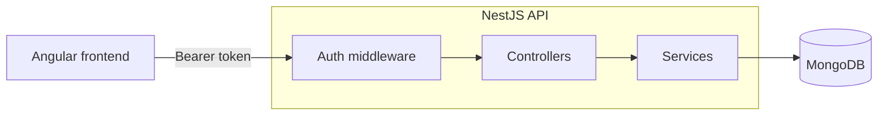
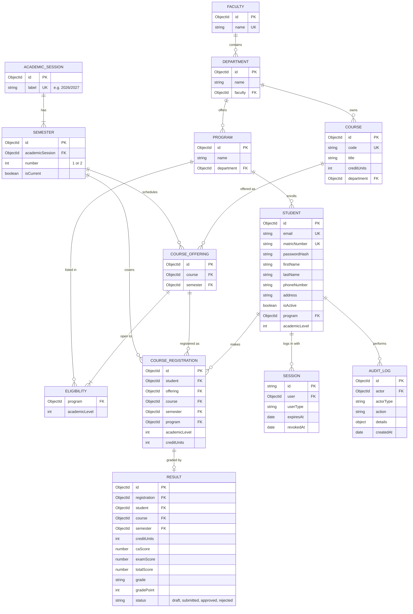

# UEMP API — University Education Management Portal (Student workflow)

Backend for the UEMP practical assessment. It implements the **Student workflow** MVP: secure login, the student's profile and academic placement, course registration for the current semester, approved results, semester GPA and CGPA.


## Tech stack

NestJS 11 (TypeScript), MongoDB with Mongoose, JWT sessions, bcrypt, class-validator, Jest and Supertest.

## Setup

```bash
npm install
cp .env.example .env    # set MONGO_URI, JWT_SECRET and DEMO_STUDENT_PASSWORD
npm run seed            # demo academic data, students and results
npm run start:dev
```
The seed can be run repeatedly without creating duplicates.

local url: http://localhost:4000/api/v1

## Test credentials

All demo students use the password `DemoStudentPass123!`.

| Student | Email | Program and level |
| --- | --- | --- |
| Tobi Ade | `demo.student1@example.test` | Computer Science, 100 level |
| Amara Okafor | `demo.student2@example.test` | Computer Science, 200 level (two semesters of results) |
| Aisha Bello | `demo.student3@example.test` | Electrical Engineering, 100 level |
| David Okon | `demo.student4@example.test` | Computer Science, 100 level |
| Chinedu Eze | `demo.student5@example.test` | Software Engineering, 100 level |
| Fatima Yusuf | `demo.student6@example.test` | Software Engineering, 200 level (two semesters of results) |
| Kemi Adeyemi | `demo.student7@example.test` | Mathematics, 100 level |
| Ibrahim Musa | `demo.student8@example.test` | Statistics, 100 level |
| Ngozi Obi | `demo.student9@example.test` | Civil Engineering, 100 level |
| Emeka Nwosu | `demo.student10@example.test` | Business Administration, 100 level |
| Zainab Lawal | `demo.student11@example.test` | Accounting, 100 level |

## API endpoints

All routes are under `/api/v1` and need `Authorization: Bearer <token>`, except login.

Swagger doc: `http://localhost:5000/docs/v1`
userName: process.env.SWAGGER_USERNAME
password: process.env.SWAGGER_PASSWORD

| Method | Path | Description |
| --- | --- | --- |
| `POST` | `/auth/login` | Log in, returns a token |
| `POST` | `/auth/logout` | End the session |
| `GET` | `/students/me` | Profile, matric number, program, department, faculty, level |
| `PATCH` | `/students/me` | Update phone number and address |
| `GET` | `/registration/available-courses` | Courses open to the student this semester |
| `POST` | `/registration` | Register courses (`{ "offeringIds": [...] }`) |
| `GET` | `/registration` | Registered courses and total units |
| `GET` | `/students/me/results` | Approved results by semester, GPA and CGPA |

## Architecture



```text
src/
  academic/      faculties, departments, programs, sessions, semesters, courses
  audit/         audit log
  auth/          login, logout, sessions
  registration/  course registration
  result/        results, grading, GPA
  student/       student profile
  seed/          demo data
```

- **Auth middleware:** Checks the token and the stored session on every protected request, then attaches the student to the request.
- **Controllers:** Read the student from the session and call a service.
- **Services:** Hold the business rules.
- **Errors:** A global filter turns errors into consistent JSON responses.

## Database design



- **Course offerings:** A course offering places a course in a semester and lists which programs and levels can take it.
- **Course registrations:** One document per course. The student's program, level and the course units are copied at registration time. A unique index on student, course and semester blocks duplicates.

## Permissions

- **Login and sessions:** Every route except login requires a valid token. The server also checks the stored session on each request, so logout and expired sessions take effect immediately.
- **Own data only:** The student comes from the session, never from the URL, so students can only see their own data.
- **Registration rules:** Students can only register courses offered this semester for their program and level, with no duplicates and at most 24 units.
- **Approved results only:** Students only see results that have been approved.
- **Passwords and rate limits:** Passwords are hashed with bcrypt, and login is limited to 10 attempts per minute.
- **Audit log:** Login, logout, profile updates and course registrations are recorded.

## Grading

CA is scored out of 40 and the exam out of 60. The scale is defined in `src/result/grading.ts`.

| Score | Grade | Point |
| --- | --- | --- |
| 70–100 | A | 5 |
| 60–69 | B | 4 |
| 50–59 | C | 3 |
| 45–49 | D | 2 |
| 40–44 | E | 1 |
| 0–39 | F | 0 |

GPA = sum of (units × grade point) ÷ sum of units, rounded to 2 decimal places. CGPA applies the same formula to all approved results.

## Tests

```bash
npm test           # grading and GPA
npm run test:e2e   # auth, registration, results and profile (uses MONGO_URI)
```
